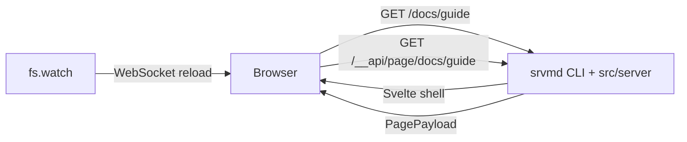

# AGENTS.md

本文件是仓库级说明，适用于整个仓库。开始修改前先读 [ARCHITECTURE.md](./ARCHITECTURE.md)；它定义了模块职责、依赖方向和页面数据契约。

## 项目概览

`srvmd` 是一个本地/局域网使用的静态文件服务器：托管目录，按需把 Markdown 渲染成 HTML，并通过 WebSocket 实时刷新。

仓库是**一个** public npm package `srvmd`，内部按运行时拆成四个项目：

| 项目         | 运行时 | 职责                                       | 项目说明                                       |
| ------------ | ------ | ------------------------------------------ | ---------------------------------------------- |
| `src/cli`    | Node   | CLI 进程边界                               | [src/cli/AGENTS.md](./src/cli/AGENTS.md)       |
| `src/server` | Node   | HTTP、resolve、Markdown、目录、live reload | [src/server/AGENTS.md](./src/server/AGENTS.md) |
| `src/web`    | 浏览器 | Svelte 5 UI；Vite 构建到 `dist/web`        | [src/web/AGENTS.md](./src/web/AGENTS.md)       |
| `src/shared` | 无     | 跨端契约、类型、协议常量                   | [src/shared/AGENTS.md](./src/shared/AGENTS.md) |

- 用户侧命令仍然是 `srvmd`，推荐用 `npx srvmd ./docs` 或 `pnpm dlx srvmd ./docs` 直接运行。
- 四个项目一起构建、一起发布；只有一个版本号，一个根 `package.json`。
- 每个项目仍保留自己的 `tsconfig`、`biome`、测试配置；`src/web` 还保留自己的 `vite.config.ts` 和 `vitest.config.ts`。
- 页面架构是服务端路由 + 客户端渲染（server-routed CSR），不是 SSR，也不是带前端 router 的 SPA。
- 没有 React、旧 SSR 或 legacy 目录。

## 全局架构边界



```plaintext
cli -> server -> shared          (src/cli -> src/server -> src/shared)
cli -> web dist                  (resolve ../../dist/web from the CLI module)
dev:  cli -> Vite dev URL        (server proxies shell and /__app/*)
web -> shared                    (@shared build-time alias)
server -/-> cli
server -/-> web
web -/-> server
web -/-> cli
shared -> nothing
```

- 保持 server-routed CSR。服务器决定 URL 对应什么资源并返回 Svelte 壳；Svelte 根据 `location.pathname` 请求 `/__api/page/<path>`。不要添加前端 router、History API 拦截或链接拦截。
- Markdown 永远在服务端渲染。`markdown-it` 和 shiki 是服务端能力；不要把 Markdown parser 或 shiki 搬进浏览器。
- 页面结构只在 Svelte 中。不要在 server 里拼页面 HTML、head 或脚本标签。
- 静态 HTML 原样服务。用户自己的 `.html` 文件不套 Svelte 壳；总是注入外部 live-reload 脚本（超过 5MB 时跳过）。
- Mermaid 走 slot + sources。server 只输出占位和源码，浏览器负责挂载和渲染；具体规则见 server / web 的 AGENTS.md。
- 保持共享契约。API 字段变化先改 `src/shared/src/contracts.ts`，再改 server 和 web，避免两端类型漂移。
- 保留内部路由前缀。`/__api/page/*`、`/__app/*`、`/__serve_md_live`、`/__serve_md_mermaid.js` 为内部使用；用户文件不要依赖这些路径。
- 不要改生成产物。`dist/` 是 `tsc` 和 Vite 的输出，包括 `dist/web/`；改源码后重新构建。
- 不要恢复 workspace 或多 package 布局；内部模块通过相对路径或 `@shared` 构建别名连接。

这些规则分两层强制：类型层面的边界由各项目 `tsconfig` 保证（`shared` 无环境类型、`shared`/`server` 不含 DOM lib、只有 `web` 映射 `@shared`），`test/architecture.test.ts` 补上 tsc 看不到的部分——跨项目相对 import、server 里的 `svelte`、web 里的 `node:*`，以及下面的包布局。

## 目录概览

```plaintext
src/
  cli/         CLI 项目
    src/       参数、启动、输出、信号、web 路径解析
    tsconfig.json / tsconfig.build.json / biome.json / vitest.config.ts
  server/      Node 运行时项目
    src/       HTTP、resolve、Markdown、services、routes、assets
    test/      测试 fixture
    tsconfig.json / tsconfig.build.json / biome.json / vitest.config.ts
  shared/      跨端契约项目
    src/       契约、类型、协议常量
    tsconfig.json / tsconfig.build.json / biome.json
  web/         Svelte 5 浏览器应用；配置在项目根，源码在 web/src
    src/       features、components、lib、styles、测试
    public/    首屏主题脚本
    vite.config.ts
    vitest.config.ts
  ...
dist/
  cli/src/     Node 构建；bin 入口 dist/cli/src/index.js
  server/src/
  shared/src/
  web/         Vite 构建产物
test/          仓库级架构测试
example/docs   示例内容
```

各项目内部目录和职责边界见对应的 AGENTS.md。

## 快速命令

```bash
pnpm install

# 构建与启动
pnpm run build                       # build:node + build:web
pnpm run build:node                  # tsc -b：shared/server/cli 到 dist
pnpm run build:web                   # Vite：src/web -> dist/web
pnpm run preview ./example/docs      # 启动编译产物（需先 build）
pnpm run dev:web                     # 开发 UI：启动 Vite dev server
pnpm run dev:node ./example/docs     # 开发模式启动 srvmd（另一个终端）

# 测试
pnpm test                            # build + Node Vitest + web Vitest
pnpm run test:node                   # 依次跑 cli、server、根目录 Node 测试
pnpm run test:cli                    # 只跑 src/cli
pnpm run test:server                 # 只跑 src/server
pnpm run test:root                   # 只跑根 test/
pnpm run test:web                    # 只跑 src/web 的 Vitest

# 类型与格式
pnpm run typecheck                   # 各项目 tsc + svelte-check
pnpm run check                       # Biome（整仓）+ web 的 Prettier Svelte 检查
pnpm run check:fix                   # 自动修复格式和 import 排序
pnpm run check:svelte                # 只检查 .svelte
pnpm run format:svelte               # 只格式化 .svelte

# 发布产物
pnpm pack                            # prepack：构建并校验 dist/web
```

注意：

- `preview` 直接运行 `dist` 下的编译产物，不会自动构建；运行前先执行 `pnpm run build`，否则 CLI 会报告 `dist/web` 缺失。
- `dev:node` 用 `tsx watch` 直接跑 `src`，不需要 `dist`。
- 开发模式用两个终端分别运行 `pnpm run dev:web` 和 `pnpm run dev:node ./example/docs`；`dev:node` 设置 `SRVMD_DEV_WEB_URL=http://localhost:5180`。浏览器要打开 srvmd 的地址，HMR 由浏览器直连 Vite。
- `tsx` 只擦除类型不做检查，类型检查靠 `pnpm run typecheck`（CI/提交前）和编辑器。
- CLI 的内容目录相对当前工作目录；在仓库根运行示例用 `./example/docs`。
- 每个项目自己的 `tsconfig` / `biome` 配置仍有效；根 `package.json` 只负责统一依赖、脚本、版本和发布清单。
- `pnpm-workspace.yaml` 只放 pnpm 12 的安装设置（`allowBuilds: esbuild`，供 `tsx` 使用），不声明 `packages`，仓库仍是单 package。

## 跨项目改动流程

### 新增页面字段

1. 在 `src/shared/src/contracts.ts` 增加字段。
2. 在 `src/server/src/routes/page-api.ts` 或对应 service 填充。
3. 在 `src/web/src/lib/api.ts` 的类型中自动获得该字段，然后在对应 Svelte 组件渲染。
4. 补 server API 测试和 web 组件测试。

### 新增页面类型

1. 在 `src/server/src/resolve/resource.ts` 定义 Resource。
2. 在 `src/server/src/routes/` 处理。
3. 在 `src/shared/src/contracts.ts` 增加 payload。
4. 在 `src/web/src/App.svelte` 切换视图，并在 `src/web/src/features/` 增加页面组件。

### 新增 CLI 参数

1. 在 `src/cli/src/command.ts` 声明。
2. 在 `src/cli/src/options.ts` 映射到 `ServerOptions`。
3. 在 `src/server/src/config.ts` 校验并加入 `ResolvedConfig`，再在消费该配置的模块使用。
4. 补 `src/cli/src/options.test.ts` 或对应行为测试。

### 只影响单个项目

| 改动                                          | 去读                                           |
| --------------------------------------------- | ---------------------------------------------- |
| CLI 参数、启动输出、信号和生命周期            | [src/cli/AGENTS.md](./src/cli/AGENTS.md)       |
| HTTP、路由、resolve、Markdown、目录、live     | [src/server/AGENTS.md](./src/server/AGENTS.md) |
| Svelte 页面、交互、Mermaid、主题、live client | [src/web/AGENTS.md](./src/web/AGENTS.md)       |
| 契约、领域类型、协议常量                      | [src/shared/AGENTS.md](./src/shared/AGENTS.md) |

## 测试

- Node 测试：`src/cli/src/**/*.test.ts`、`src/server/src/**/*.test.ts`、根 `test/*.test.ts`，用 Vitest。
- Web 测试：`src/web/src/**/*.test.ts`，用 Vitest + Testing Library + jsdom。
- 每个项目有自己的 Vitest 配置：`src/cli/vitest.config.ts`、`src/server/vitest.config.ts`、`src/web/vitest.config.ts`；根 `vitest.config.ts` 只跑 `test/`。
- 架构边界：`test/architecture.test.ts` 只扫描 tsc 拦不住的东西（跨项目相对 import、server 里的 `svelte`、web 里的 `node:*`）；类型层面的边界靠 tsconfig。两层都不要为了通过检查而放宽。
- 包不变量：`test/architecture.test.ts` 同时检查单根 `package.json`、`bin`、`files`、没有 workspace 和没有 `@srvmd/*` 依赖。
- 各项目的测试细节、fixture 和 mock 约定见对应 AGENTS.md。

## 代码风格

- TypeScript 严格模式，`verbatimModuleSyntax`：类型导入使用 `import type`。
- 导入 Node 内置模块统一用 default import 取模块对象，不要用 named import：`import fs from "node:fs"`、`import fsp from "node:fs/promises"`、`import path from "node:path"`、`import os from "node:os"`、`import url from "node:url"`，调用处写 `fs.existsSync(...)`、`path.join(...)`。类型同理，写 `import type fs from "node:fs"` 后用 `fs.Stats`。
- TS/JSON/CSS/HTML 用 Biome；Svelte 用 Prettier + `prettier-plugin-svelte`。不要用 Biome 格式化 `.svelte`。
- Prettier 的配置 `.prettierrc.json` 和依赖在根 package；`.svelte` 由 `src/web/.prettierrc.json` 控制。
- 代码注释用英文；`README.md` 用英文，`README_CN.md` / `ARCHITECTURE.md` / AGENTS.md 用中文。
- 保持模块聚焦。一个文件承担多个职责时优先拆分。
- 不要新增 React、旧 SSR、内联脚本或前端 router。
- 不要用 `{@html}` 插入未受信任的内容。合法边界只有 Markdown 正文和 Mermaid SVG。
- 项目内 import 约定见各项目 AGENTS.md。

### Biome 配置分层

- 根 `biome.json` 是 `root: true`，只定义共享选项和根目录文件：`biome.json`、`package.json`、`tsconfig.json`、`tsconfig.build.json`、`vitest.config.ts`、`test/**`。
- `src/cli`、`src/server`、`src/shared`、`src/web` 各有 `biome.json`，使用 `root: false` 加 `extends: "//"` 继承根配置，并声明自己的范围。
- `src/web/biome.json` 显式排除 `**/*.svelte`；`.svelte` 由 `src/web/.prettierrc.json` 负责。
- 根脚本不直接调用 Prettier，而是转调 `check:svelte` / `format:svelte`；Prettier 依赖放在根 package。
- 从仓库根运行 `biome check .` 会下钻到各项目，并按最近的 `biome.json` 应用设置。

## 构建与发布

- 根 `package.json` 的 `bin.srvmd` 指向 `./dist/cli/src/index.js`；`dist/cli/src/index.js` 保留 `#!/usr/bin/env node`。
- `build:node` 执行 `tsc -b tsconfig.build.json`，输出 `dist/{shared,server,cli}`；`build:web` 执行 Vite，输出 `dist/web`。
- `prepack` 执行完整构建，再用 `src/web/scripts/verify-dist.ts` 校验 `dist/web` 完整。
- `files` 只包含 `dist`、README、README_CN、LICENSE；不发布 `src`、测试、AGENTS、ARCHITECTURE 或 CHANGELOG。变更记录只在 GitHub Release 中维护。
- 发布前执行 `pnpm pack`，确认 tarball 包含 `dist/cli/src/index.js`、`dist/server/src`、`dist/shared/src`、`dist/web`，没有 `src/`、测试或 `web/node_modules`。
- 不要恢复 `@srvmd/*` 子包或 workspace；旧的 `@srvmd/server`、`@srvmd/web`、`@srvmd/shared` 只作为历史包保留，发版时用 `npm deprecate` 提示合并到 `srvmd`。
- 版本升级只改根 `package.json`，再执行 `pnpm install` 更新 lockfile。

## 完成前检查

在提交或结束任务前至少运行：

```bash
pnpm run check
pnpm test
pnpm run typecheck
pnpm run build
```

涉及发布配置时再执行 `pnpm pack` 并检查 tarball。

## 代码规范

1. 如果声明的变量、类型，没有起到复用的作用，则不应该单独声明。
2. 代码实现要以实现功能作为唯一目标，不能为了方便测试而编写与功能实现无关的代码。例如不能为了方便测试，而在函数中添加实际调用用不到，只在测试场景才会用到的参数。
3. 如果其它模块用不到，那就不应该随便 export 定义的变量、类型以及函数。
