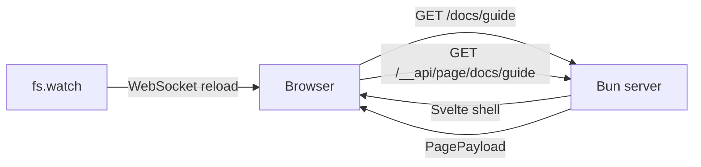

# AGENTS.md

本文件面向在本仓库中工作的 AI coding agents。开始修改前先读 [ARCHITECTURE.md](./ARCHITECTURE.md)；它定义了目录职责、依赖方向和页面数据契约。

## 项目概览

`serve-markdown` 是一个本地/局域网使用的静态文件服务器：托管目录，按需把 Markdown 渲染成 HTML，并通过 WebSocket 实时刷新。

- 运行时：Bun，入口 `src/cli/index.ts`。
- 页面：Svelte 5，源码在 `web/`，构建产物在 `web/dist/`。
- 架构：服务端路由 + 客户端渲染（server-routed CSR）。
- 不是 SSR，也不是带前端 router 的 SPA。
- 服务端负责 Markdown、shiki、文件解析、HTTP 语义；浏览器负责页面结构和交互。
- 没有 React、旧 SSR 或 legacy 目录。

## 快速命令

```bash
bun install
bun run build                    # 构建 web/dist
bun run start example/docs       # 启动服务器，默认新架构
bun run dev                      # watch 模式启动服务器
bun run dev:web                  # Vite build --watch，开发 UI 时与 dev 同时运行
bun run test                     # Bun + Vitest
bun run test:server              # Bun：server、shared、API/parity
bun run test:web                 # Vitest：Svelte 组件和浏览器逻辑
bun run test:e2e                 # Playwright 真实浏览器 E2E
bun run typecheck                # tsc + svelte-check
bun run check                    # Biome + Prettier --check
bun run check:fix                # 自动修复格式和 import 排序
bun pm pack                      # 验证发布产物
```

注意：

- 在仓库里直接 `bun run start` 前需要先 `bun run build`，否则壳会返回 503；npm/bun 安装包自带 `web/dist`。
- `bun test` 只跑 Bun 测试，`bunfig.toml` 已排除 `web/**` 和 `test/e2e/**`。完整单元测试用 `bun run test`。
- Vitest 只跑 `web/**/*.test.ts`，不要用它跑 server 测试。
- `test:e2e` 不包含在 `bun run test` 中，需要单独运行。
- `web/dist` 是生成产物，不要手改。

## 架构边界



```plaintext
cli -> server -> shared
web -> shared
server -/-> web   (only serves web/dist as files)
web -/-> server
shared -> nothing
```

- `src/cli/` 只负责参数解析、启动、输出和信号。
- `src/server/` 可以使用 Bun/Node API，不能导入 `web/` 或 `cli/`。
- `web/` 可以使用 DOM/浏览器 API，不能导入 `server/`、`cli/`、`node:*` 或使用 `Bun`。
- `src/shared/` 只放跨端契约、类型、常量，不依赖任何运行时。
- `server` 和 `shared` 不能访问 DOM 全局。
- 这些规则由 `test/architecture.test.ts` 扫描 `.ts` 和 `.svelte` 的 import 强制检查，不要绕过。

## 目录职责

```plaintext
src/
  cli/                 Commander CLI、启动、输出、信号
  server/              Bun 运行时
    config.ts          ServeMarkdownOptions -> ResolvedConfig
    constants.ts       服务端常量
    context.ts         高亮器、文档缓存、live 等长生命周期服务
    create-server.ts   Bun.serve 组装
    types.ts           ResolvedPath、DirectoryEntry 等服务端类型
    path.ts            路径安全辅助
    file-kinds.ts      扩展名分类
    http/              Response/headers/ETag/304 原语
    routes/            URL -> handler 编排
    resolve/           URL -> 安全 Resource
    services/          documents、directories、live
    markdown/          Markdown -> HTML/TOC/Mermaid sources
    assets/            web build 和 Mermaid runtime
  shared/              跨端 API 契约、类型、协议常量
web/
  index.html           应用壳
  src/main.ts          Svelte mount
  src/App.svelte       加载 page payload，切换视图
  src/features/        document、directory、mermaid、theme、live
  src/components/      跨 feature 的展示组件
  src/lib/             API client、config、formatting
  src/live-static.ts   静态 HTML 的预构建 live reload
  src/styles/          app、markdown、mermaid CSS
  public/theme-boot.js 首屏前执行的主题初始化
test/
  architecture.test.ts import 边界测试
  server-fixture.ts    API/parity 测试用临时目录和 Svelte 壳
  fixture.ts           路径/目录单元测试 fixture
  e2e/                 Playwright smoke 用例
```

## 不可破坏的规则

1. **保持 server-routed CSR。** 服务器决定 URL 对应什么资源并返回 Svelte 壳；Svelte 根据 `location.pathname` 请求 `/__api/page/<path>`。不要添加前端 router、History API 拦截或链接拦截。
2. **Markdown 永远在服务端渲染。** `Bun.markdown` 和 shiki 是服务端能力；不要把 Markdown parser 或 shiki 搬进浏览器。
3. **页面结构只在 Svelte 中。** 不要在 server 里拼页面 HTML、head 或脚本标签，除了 shell 的 config JSON 注入。
4. **新页面没有内联客户端 JS。** 主题初始化使用阻塞脚本 `web/public/theme-boot.js`；静态 HTML live reload 使用预构建的 `/__app/live-static.js`；新 Svelte 页面使用打包后的 live client。不要往 `web/index.html` 或 shell 里加内联脚本。
5. **Mermaid 走 slot + sources。** 服务端只输出 `<div data-mermaid-slot="...">`，源码通过 `PagePayload.mermaid` 传给浏览器。不要在服务端生成 figure HTML，也不要从 DOM 抓 `textContent`。`web/src/features/mermaid/slots.ts` 是唯一把 Svelte 组件挂载到 `{@html}` slot 的位置。
6. **Mermaid 每次渲染使用唯一 id。** 不要缓存 SVG 后在 inline 图和 viewer 中复用，否则会产生重复 SVG id。`bindFunctions` 必须在 SVG 插入后调用。
7. **静态 HTML 原样服务。** 用户自己的 `.html` 文件不套 Svelte 壳；只在 live 开启时注入外部 live-reload 脚本。
8. **保留内部路由前缀。** `/__api/page/*`、`/__app/*`、`/__serve_md_live`、`/__serve_md_mermaid.js` 为内部使用；用户文件不要依赖这些路径。
9. **不要改生成产物。** `web/dist/`、`test-results/`、`playwright-report/` 都是生成/测试产物；改源码后重新构建。
10. **保持共享契约。** API 字段变化先改 `src/shared/contracts.ts`，再改 server 和 web，避免两端类型漂移。
11. **路径只解码一次。** API 路径来自 URL pathname；`resolveRequest` 负责解码。不要在调用链里再次 `decodeURIComponent`。
12. **测试按运行时分工。** Bun 测试放 `src/server/` 或 `src/cli/`；浏览器测试放 `web/src/**/*.test.ts`；E2E 放 `test/e2e/`。

## 如何添加功能

### 新增页面字段

1. 在 `src/shared/contracts.ts` 增加字段。
2. 在 `src/server/routes/page-api.ts` 或对应 service 填充。
3. 在 `web/src/lib/api.ts` 的类型中自动获得该字段。
4. 在对应的 Svelte 组件渲染。
5. 补 server API 测试和 web 组件测试。

### 新增交互控件

只改 `web/src/features/<feature>/`。需要服务端数据时，再增加 shared 契约和 API 字段。不要把控件逻辑放进 `server/`。

### 新增 Markdown 语法

只改 `src/server/markdown/`。如果产生交互占位，增加 shared 数据，并在 `web/src/features/` 增加对应 Svelte 组件。

### 新增 CLI 参数

1. 在 `src/cli/command.ts` 声明。
2. 在 `src/cli/options.ts` 映射到 `ServeMarkdownOptions`。
3. 在 `src/server/config.ts` 校验并加入 `ResolvedConfig`。
4. 在消费该配置的模块使用。
5. 补 `src/cli/options.test.ts` 或对应行为测试。

### 新增页面类型

1. 在 `src/server/resolve/resource.ts` 定义 Resource。
2. 在 `src/server/routes/` 处理。
3. 在 `src/shared/contracts.ts` 增加 payload。
4. 在 `web/src/App.svelte` 切换视图，并在 `web/src/features/` 增加页面组件。

## 测试

- 服务端测试：`src/server/**/*.test.ts`，用 `bun:test`。
- CLI 测试：`src/cli/**/*.test.ts`，用 `bun:test`。
- Web 测试：`web/src/**/*.test.ts`，用 Vitest + Testing Library + jsdom。
- 架构边界：`test/architecture.test.ts`，不要为了通过测试放宽 import 规则。
- E2E：`test/e2e/*.spec.ts`，用 Playwright。
- 临时目录：服务端 API/parity 用 `test/server-fixture.ts`；路径/目录单测用 `test/fixture.ts`。
- Mermaid 组件测试要 mock `./render.ts`，不要加载真实 Mermaid runtime；`web/src/test/setup.ts` 已提供 dialog polyfill。
- 修 bug 时优先补回归测试；新增 HTTP 行为时同时检查 `src/server/routes/page-api.test.ts` 和 `src/server/routes/parity.test.ts`。

## 构建与发布

- Vite 有两个入口：`web/index.html` 和 `web/src/live-static.ts`。后者固定输出 `web/dist/live-static.js`，由服务端以 `/__app/live-static.js` 提供。
- `web/public/theme-boot.js` 会被复制到 `web/dist/theme-boot.js`，以 `/__app/theme-boot.js` 提供；它必须在 `<head>` 中阻塞执行，避免主题闪烁。
- 新增客户端入口时，同时更新 `web/vite.config.ts`、`src/server/assets/` 或 `src/shared/constants.ts` 中的路径。
- `prepack` 会自动执行 `bun run build`。
- 修改 `bin`、构建产物或依赖后，用 `bun pm pack` 后安装到临时目录验证：

```bash
bun pm pack
# 在临时目录安装 tarball，确认 serve-markdown --version 和启动正常
```

## WSL 与 E2E

当前开发环境是 WSL2。headless Playwright 不需要 X server，但宿主机可能缺少 Chromium 系统库。没有 sudo 依赖时，用 Docker：

```bash
docker run --rm --ipc=host \
  -v "$PWD":/work -w /work -v /work/node_modules \
  oven/bun:1.4.3-debian \
  bash -lc 'bun install --frozen-lockfile && bunx playwright install --with-deps chromium && bun run test:e2e'
```

容器可能以 root 写入 `web/dist/` 和 `test-results/`；出现权限问题时用 Docker `chown`/`rm` 清理，或在宿主机重新 `bun run build`。

## 代码风格

- TypeScript 严格模式，`verbatimModuleSyntax`：类型导入使用 `import type`。
- 服务端相对导入保留 `.ts` 后缀；Web 使用 `@shared` 和 `$lib` 别名，跟随现有文件。
- TS/JSON/CSS/HTML 用 Biome；Svelte 用 Prettier + `prettier-plugin-svelte`。不要用 Biome 格式化 `.svelte`。
- 代码注释用英文，README/ARCHITECTURE 用中文。
- 保持模块聚焦。一个文件承担多个职责时优先拆分；Mermaid 的 `load/render/viewport/viewer/diagram` 就是参照。
- 不要新增 React、旧 SSR、内联脚本或前端 router。
- 不要用 `{@html}` 插入未受信任的内容。合法边界只有 Markdown 正文、Mermaid SVG 和 shell config JSON。

## 完成前检查

在提交或结束任务前至少运行：

```bash
bun run check
bun run typecheck
bun run test
bun run build
```

涉及真实页面导航、Mermaid 查看器、主题持久化或静态资源时，再运行 E2E。涉及发布配置时再运行 `bun pm pack` 并检查 tarball。
