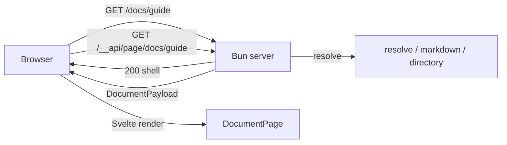
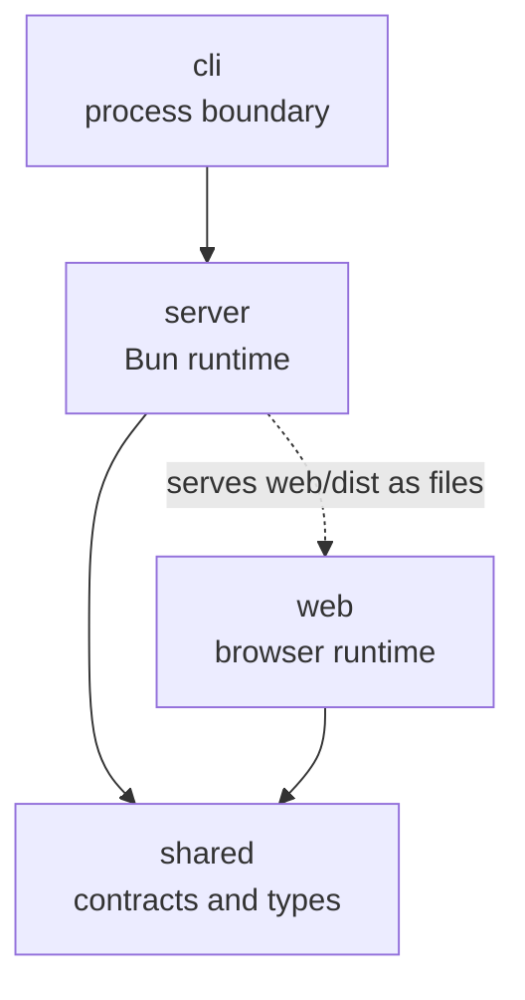
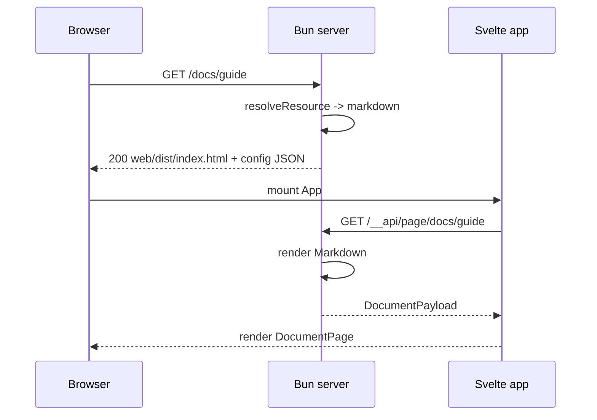

# 架构说明

## 产品约束

- 只在本地和局域网使用，不面向公网。
- 单进程 Bun 服务，托管任意目录，按需渲染 Markdown。
- 首屏速度、SEO、无 JavaScript 访问不是硬约束；可维护性优先。
- Mermaid 运行时体积很大，只在文档包含图表时懒加载。

## 架构决定

采用 **服务端路由 + 客户端渲染（server-routed CSR）**，不采用 SSR，也不采用带前端 router 的 SPA。

- 服务器决定 URL 对应什么资源，并处理 clean URL、目录索引、`?raw`、301、404、静态文件。
- 浏览器每次导航都是一次完整的页面请求。
- 对 Markdown 和目录路由，服务器返回同一个 Svelte 壳。
- Svelte 根据 `location.pathname` 请求 `/__api/page/<path>`，拿到页面数据后渲染。
- 不做前端 router，不拦截 `<a>`，不维护 history。

这样只有一套路由规则，客户端不需要重复实现服务端已经拥有的路径语义。以后需要 SPA 式切换时，可以在同一个 API 上增加 router，服务器仍为深链接返回壳。



## 运行时边界



- `server` 可以使用 Bun 和 Node API，不导入 `web` 源码，不访问 DOM。
- `web` 可以使用 DOM 和浏览器 API，不导入 `server` 源码，不读文件系统。
- `shared` 只包含类型、契约和常量，不依赖任何运行时。
- `cli` 只负责进程边界：解析参数、启动服务器、输出、信号，以及跟随终端和父进程退出。

## 进程生命周期

`src/cli/lifecycle.ts` 决定服务器何时退出，三条触发路径最终都走同一个 `shutdown`：

| 触发 | 机制 | 备注 |
| --- | --- | --- |
| `Ctrl+C`、`SIGTERM`、`SIGHUP` | 信号处理器 | 注册后覆盖继承来的 `SIG_IGN`（`nohup`、部分终端启动器） |
| 终端关闭 | 每秒 `readlink /proc/self/fd/{0,1,2}` | 仅 Linux，其他平台没有 `/proc` |
| 父进程消失 | 每秒比对 `process.ppid` | 只覆盖启动之后父进程才消失的情况 |

约定：

- `shutdown` 先 `running.close()`，再 `process.exit(0)`；重复信号只生效一次。
- 处理器紧跟 `startServer` 安装，`--open` 等可能阻塞的操作不能挡在中间。
- 启动时就已是孤儿（reaper 或容器 `PID 1` 为父进程）无法与 supervisor 拉起区分，因此不做处理；要常驻请用 systemd、Docker 等 supervisor。
- 因为信号处理器覆盖了 `SIG_IGN`，`nohup` 和 `setsid` 都不能让服务脱离终端存活。

## 目录职责

```plaintext
src/
  cli/                 process boundary
  server/              Bun runtime
    config.ts          options -> ResolvedConfig
    constants.ts       server constants
    context.ts         long-lived services
    create-server.ts   Bun.serve assembly
    types.ts           server-only types
    path.ts            safe path helpers
    file-kinds.ts      extension classification
    http/              response/header/validator primitives
    routes/            URL to handler orchestration
    resolve/           URL to safe filesystem resource
    services/          documents, directories, live
    markdown/          Markdown to HTML + TOC + Mermaid sources
    assets/            web build and Mermaid runtime
  web/                 browser runtime, all UI
    src/features/      document, directory, mermaid, theme, live
    src/components/    cross-feature presentational components
    src/lib/           API client, config, formatting
    src/live-static.ts prebuilt static-page live reload
    src/styles/        app, markdown, mermaid CSS
    public/theme-boot.js pre-paint theme bootstrap
  shared/              contracts, types, protocol constants
test/                  integration fixtures and Playwright E2E
```

| 目录 | 只负责 | 不负责 |
| --- | --- | --- |
| `cli/` | 参数、启动、输出、信号 | 业务逻辑、UI |
| `server/http/` | Response、headers、ETag、304 | Markdown、目录、页面结构 |
| `server/routes/` | URL 到 handler 的编排 | 业务实现 |
| `server/resolve/` | URL 到安全 Resource | 渲染 |
| `server/services/` | 文档、目录、live 用例 | 拼页面 HTML |
| `server/markdown/` | Markdown 到 HTML、TOC、Mermaid 数据 | 页面壳 |
| `web/features/*` | 一个功能的组件和客户端逻辑 | 读文件、导入 server |
| `web/components/` | 跨 feature 的展示组件 | 发请求 |
| `shared/` | 跨端契约、纯类型、常量 | 任何运行时依赖 |

## 依赖规则

```plaintext
cli -> server -> shared
web -> shared
server -/-> web   (only serves web/dist as static files)
web -/-> server
shared -> nothing
```

约束由架构测试扫描 `.ts` 和 `.svelte` 的 import 来保证：

- `shared` 不能导入 `cli`、`server`、`web`，不能使用任何运行时 API。
- `server` 只能导入 `src/server/`、`src/shared/` 和外部依赖，不能导入 `web` 或 `cli`。
- `web` 只能导入 `src/shared/`、自身和浏览器端外部依赖，不能导入 `server`、`cli`、`node:*` 或使用 `Bun`。
- `cli` 只能导入 `cli`、`server`、`shared`、`package.json` 和外部依赖，不能导入 `web`。
- `server` 和 `shared` 不能使用浏览器 DOM 全局（如 `window.`、`document.querySelector`）。

这些规则由 `test/architecture.test.ts` 扫描 `.ts` 和 `.svelte` 的 import 来保证。

## 请求流



## 内部路由

| 路径 | 用途 |
| --- | --- |
| `/__api/page/<path>` | 返回文档或目录的页面数据 |
| `/__app/*` | Vite 构建产物，避开用户的 `/assets` |
| `/__serve_md_live` | WebSocket 实时刷新 |
| `/__serve_md_mermaid.js` | Mermaid 浏览器运行时 |

用户路径保持原样：

- Markdown 和目录路由返回 Svelte 壳。
- 静态文件和静态 HTML 直接返回。
- Markdown 加 `?raw` 返回源码。
- 目录缺少结尾 `/` 时返回 301。
- 不存在的路径返回壳，HTTP 状态为 404，Svelte 渲染错误页。
- `-s` 回退到 `index.html` 时仍按用户静态 HTML 返回；回退到 `index.md` 时走 Svelte 壳。

## 实时刷新

- watcher 监听 root 下的每个目录；文件写入和目录增删都会产生事件，事件在 `WATCH_DEBOUNCE_MS` 后合并发送，持续写入时由 `WATCH_MAX_WAIT_MS` 强制 flush。
- WebSocket 载荷为 `{ type: "reload", files: string[] }`，`files` 是相对 root 的路径（POSIX 分隔符），目录路径不带结尾 `/`。
- 服务端先 `documents.invalidate()` 再广播，客户端重取时不会命中旧缓存；只有 Markdown 路径会进入文档缓存。
- 浏览器不会一有事件就重取：`web/src/features/live/live.ts` 用与 resolver 一致的 clean URL 规则判断事件是否影响当前页。目录页对子树变更敏感，文档页只对自身源文件敏感（`/guide/` 上的 `guide/index.md` 不会因 `guide/other.md` 重取），`--single` 模式下全量刷新，CSS 变更触发整页 reload。
- 条件重取使用 `ETag` / `If-None-Match`；命中 304 时保留当前页面状态。
- 静态 HTML 页面不参与上述判断，`/__app/live-static.js` 收到任何事件都会整页 reload。

## Page API 的条件请求

`GET /__api/page/*` 返回 `ETag` 并支持 `If-None-Match`（弱比较，支持 `*`）。ETag 由配置项、URL、源文件相对路径和内容 revision 组合而成；页面数据字段变化时必须在 `server/routes/page-api.ts` 的 `documentEtag` / `directoryEtag` 同步，否则条件请求会返回过期的 304。

## 页面数据契约

```typescript
type DocumentPayload = {
  kind: "document";
  path: string;
  title: string;
  html: string;
  toc: TocItem[];
  mermaid: MermaidSource[];
  breadcrumbs: Breadcrumb[];
  rawHref: string;
  warning?: string;
  lang?: string;
};

type DirectoryPayload = {
  kind: "directory";
  path: string;
  heading: string;
  parentHref?: string;
  entries: DirEntry[];
  breadcrumbs: Breadcrumb[];
};
```

`html` 是 Markdown 内容，不是页面结构。Mermaid 在 `html` 中只留下 `<div data-mermaid-slot="mermaid-1">` 占位，源码通过 `mermaid` 数组传给 `MermaidDiagram.svelte`。

信任边界：

- Markdown 正文 HTML 由服务端生成，客户端通过 `{@html}` 插入。
- Mermaid 返回的 SVG 由 Mermaid 运行时生成，客户端通过 `{@html}` 插入。
- 除这两处和 config JSON 外，UI 中不再出现字符串 HTML 或 `innerHTML`。
- 主题启动是外置的阻塞脚本 `web/public/theme-boot.js`，不是内联 JS。
- 静态 HTML 的 live reload 只注入 `<script type="module" src="/__app/live-static.js">`，脚本本身由 Vite 预构建，不再是内联字符串。

## 如何添加功能

### 新增页面字段

1. 在 `shared/contracts.ts` 增加字段。
2. 在 `server/page-api.ts` 或对应 service 填充。
3. 在 `web/lib/api.ts` 的类型中自动获得该字段。
4. 在对应 Svelte 组件渲染。

### 新增交互控件

只修改 `web/src/features/<feature>/`。需要服务端数据时，再增加 shared 契约和 API 字段。

### 新增 Markdown 语法

只修改 `server/markdown/`。如果产生交互占位，再在 shared 中增加数据，并在 `web/features/` 中增加对应组件。

### 新增 CLI 参数

1. 在 `cli/command.ts` 声明。
2. 在 `cli/options.ts` 映射到 `ServeMarkdownOptions`。
3. 在 `server/config.ts` 校验并加入 `ResolvedConfig`。
4. 在消费该配置的模块使用。

### 新增文件类型或路由

修改 `server/resolve/` 和 `server/routes/`，不要在 UI 中判断文件类型。

## 构建与测试

```plaintext
bun run build        # Vite 构建 web/dist
bun run dev:web      # Vite build --watch
bun run start        # 启动服务器
bun run test:server  # Bun test：server、shared 与 API/parity
bun run test:web     # Vitest：Svelte 组件和浏览器端逻辑
bun run test:e2e     # Playwright：真实浏览器 E2E
bun run typecheck    # tsc + svelte-check
bun pm pack          # 验证发布产物包含 web/dist
```

测试分工：

- `bun test` 负责 Bun 运行时：API、resolve、Markdown、CLI 纯函数。
- Vitest 负责浏览器运行时：Svelte 组件、viewport 数学、API 客户端。
- Playwright 做端到端测试：真实导航、Mermaid 查看器、主题、静态资源和 404。

## 当前状态

迁移已完成：

- 目录只保留 `cli / server / web / shared`，旧 React SSR、旧 Mermaid 客户端、旧 CLI 和 React 依赖已删除。
- `config / resolve / markdown / directory / live` 全部位于 `src/server/`，新服务器只导入 `server/` 和 `shared/`。
- 新服务器提供 `/__api/page/*`、Svelte 壳、`/__app/*` 静态资源和 Mermaid 运行时。
- 新 Svelte 应用支持文档页、目录页、错误页、主题切换、加载态、live reload、Mermaid 图表和查看器。
- 命令名 `srvmd` 指向 `src/cli/index.ts`。
- parity 已覆盖 clean URL、`?raw`、目录重定向、静态文件、ETag/304/Range、CORS、隐藏文件、错误状态、`-s`、`--no-live`、`--no-mermaid`、`--no-clean-urls`、`--no-directory-listing`、`--theme`、`--html`、`--highlight`、`--cors`。
- MermaidDiagram / MermaidViewer 已覆盖渲染、错误、点击/键盘打开、缩放、Fit、关闭和主题重绘。
- Playwright E2E 的 5 个 smoke 用例已在 WSL2 + Docker 中全部通过；宿主机缺少 Chromium 系统库时，可继续用 Docker 运行。
- 静态 HTML 的 live reload 使用预构建的 `/__app/live-static.js`；主题启动使用预构建的 `/__app/theme-boot.js`，新页面不包含内联客户端 JS。
