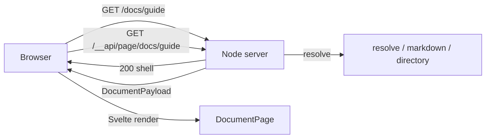
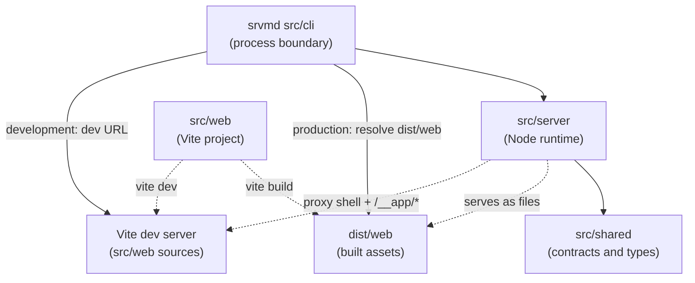
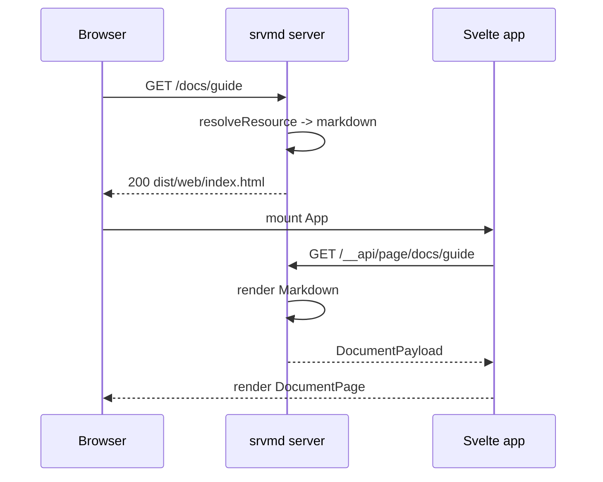
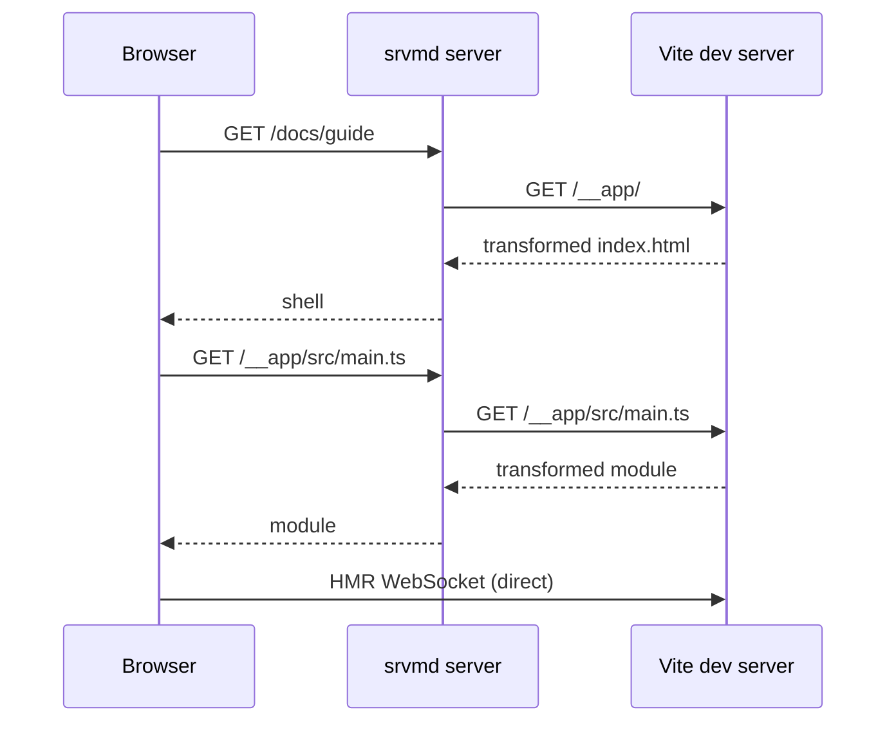

# 架构说明

## 产品约束

- 只在本地和局域网使用，不面向公网。
- 单进程 Node 服务，托管任意目录，按需渲染 Markdown。
- 实时刷新是核心功能，不提供关闭开关：使用场景就是跟随 agent 高频修改的 Markdown。
- 首屏速度、SEO、无 JavaScript 访问不是硬约束；可维护性优先。
- Mermaid 运行时体积很大，只在文档包含图表时懒加载。

## 架构决定

采用 **服务端路由 + 客户端渲染（server-routed CSR）**，不采用 SSR，也不采用带前端 router 的 SPA。

- 服务器决定 URL 对应什么资源，并处理目录列表、`?raw`、301、404、静态文件。
- 浏览器每次导航都是一次完整的页面请求。
- 对 Markdown 和目录路由，服务器返回同一个 Svelte 壳。
- Svelte 根据 `location.pathname` 请求 `/__api/page/<path>`，拿到页面数据后渲染。
- 不做前端 router，不拦截 `<a>`，不维护 history。

这样只有一套路由规则，客户端不需要重复实现服务端已经拥有的路径语义。以后需要 SPA 式切换时，可以在同一个 API 上增加 router，服务器仍为深链接返回壳。



## 运行时边界



- `src/server` 只使用 Node API，不导入 `src/cli` 或 `src/web` 源码，不访问 DOM。
- `src/cli` 只负责进程边界：解析参数、启动服务器、输出、信号，以及跟随终端退出。
- `src/web` 可以使用 DOM 和浏览器 API，不导入 `src/server`、`src/cli` 源码，不读文件系统。
- `src/shared` 只包含类型、契约和常量，不依赖任何运行时。

仓库是**一个** public npm package `srvmd`，内部包含四个项目：`src/cli`、
`src/server`、`src/shared` 和 `src/web`。它们一起构建、一起发布到一个 tarball；
只有一个版本号和一个根 `package.json`。Node 项目编译到 `dist/cli/src`、
`dist/server/src`、`dist/shared/src`，web 的 Vite 产物输出到 `dist/web`。CLI 通过
`new URL("../../dist/web", import.meta.url)` 定位构建产物，不经过包解析；
server 通过 `ServerOptions.web` 接收这个目录。开发时 `src/web` 运行 Vite dev
server，`srvmd` 通过 `SRVMD_DEV_WEB_URL` 代理它的 shell 和 `/__app/*`；HMR
WebSocket 由浏览器直连 Vite。模块边界由 `test/architecture.test.ts` 检查。

## 进程生命周期

`src/cli/src/lifecycle.ts` 只处理信号：`Ctrl+C`（`SIGINT`）、`SIGTERM` 和 `SIGHUP` 都走同一个 `shutdown`。注册 JS 处理器会覆盖继承来的 `SIG_IGN`，所以 `nohup` 或 supervisor 拉起的进程也能收到挂断信号。

约定：

- `shutdown` 先 `running.close()`，再 `process.exit(0)`；重复信号只生效一次。
- 处理器紧跟 `startServer` 安装，`--open` 等可能阻塞的操作不能挡在中间。
- 不追踪父进程，也不轮询终端：启动者退出或进程已脱离终端时服务继续运行，用 `kill` 结束。需要常驻时交给 systemd、Docker 等 supervisor。

## 目录职责

```plaintext
src/
  cli/                 srvmd CLI project
  server/              Node runtime project
  shared/              contracts, types, protocol constants project
  web/                 browser runtime; Vite project

dist/                  generated build output, shipped with the package
test/                  repository-level architecture tests
example/docs           sample content
```

各项目的内部目录与职责见对应的 `AGENTS.md`。

## 依赖规则

```plaintext
cli -> server -> shared          (src/cli -> src/server -> src/shared)
cli -> web dist                  (resolve dist/web, serve its dist)
dev:  cli -> Vite dev URL        (server proxies shell and /__app/*)
web -> shared                    (build-time constants and types)
server -/-> cli
server -/-> web
web -/-> server
web -/-> cli
shared -> nothing
```

- `shared` 只导出 `src/shared/src/index.ts` 一个入口，按 namespace 提供 `constants`、`contracts`、`types`；不使用裸 `export * from`。
- `server` 只能导入自身、`src/shared` 和外部依赖，不能导入 `src/cli`、`src/web`。dev 模式只通过 HTTP 访问 Vite，不导入 Vite。
- `web` 只能导入自身、`@shared` 别名和浏览器端外部依赖，不能导入 `server`、`cli` 或 `node:*`。
- `cli` 只能导入自身、`src/server/src/index.ts` 根入口和外部依赖，不能深层导入 server 内部模块，也不能导入 `web` 源码或 `src/web`。
- `server` 和 `shared` 不能使用浏览器 DOM 全局（如 `window.`、`document.querySelector`）。
- CLI 正式模式只解析 `dist/web` 的路径，不 import web 源码；路径锚定在 `src/cli` 自身，不依赖 CWD。

类型层面的边界由各项目 `tsconfig.json` 保证：`shared` 不引入环境类型，`shared` 和
`server` 不含 DOM lib，只有 `web` 映射 `@shared`。`test/architecture.test.ts` 扫描
`src/cli`、`src/server`、`src/shared`、`src/web/src` 中的 `.ts` 和 `.svelte` import，
覆盖 tsc 看不到的部分：跨项目但能解析的相对 import、server 里的 `svelte`、web 里的
`node:*`；CLI 只能通过 `src/server/src/index.ts` 根入口进入 server。测试同时检查仓库
只有一个根 `package.json`、`bin` 指向 `dist/cli/src/index.js`，并且没有 workspace 或
`@srvmd/*` 依赖。

## 请求流

正式模式：



开发模式把 shell 和 `/__app/*` 换成 Vite：



开发模式不缓存 shell，Vite 不可用时返回 503。正式模式继续使用 `src/web`
包内的 `dist` 和基于 mtime 的 shell 缓存。

## 内部路由

| 路径                     | 用途                                                     |
| ------------------------ | -------------------------------------------------------- |
| `/__api/page/<path>`     | 返回文档或目录的页面数据                                 |
| `/__app/*`               | 正式模式为 Vite 构建产物；开发模式代理到 Vite dev server |
| `/__serve_md_live`       | WebSocket 实时刷新                                       |
| `/__serve_md_mermaid.js` | Mermaid 浏览器运行时                                     |

用户路径保持原样：

- Markdown 和目录路由返回 Svelte 壳。
- 静态文件和静态 HTML 直接返回。
- Markdown 加 `?raw` 返回源码。
- 目录缺少结尾 `/` 时返回 301。
- `IGNORED_NAMES` 中的目录段（如 `node_modules`、`__pycache__`）返回 404，不出现在目录列表中。
- 不存在的路径返回壳，HTTP 状态为 404，Svelte 渲染错误页。

## 实时刷新

- watcher 监听 root 下的每个目录；文件写入和目录增删都会产生事件，事件在 `WATCH_DEBOUNCE_MS` 后合并发送，持续写入时由 `WATCH_MAX_WAIT_MS` 强制 flush。
- WebSocket 载荷为 `{ type: "reload", files: string[] }`，`files` 是相对 root 的路径（POSIX 分隔符），目录路径不带结尾 `/`。
- 服务端先 `documents.invalidate()` 再广播，客户端重取时不会命中旧缓存；只有 Markdown 路径会进入文档缓存。
- 浏览器不会一有事件就重取：`src/web/src/features/live/live.ts` 对文档页自身源文件、同目录 Markdown（用于左侧文档列表）和 CSS 变更敏感；目录页对自身目录子树和 CSS 变更敏感；CSS 变更触发整页 reload。
- 条件重取使用 `ETag` / `If-None-Match`；命中 304 时保留当前页面状态。
- 静态 HTML 页面不参与上述判断，live-static 客户端收到任何事件都会整页 reload。正式模式加载 `/__app/live-static.js`，开发模式加载 Vite 的 `/__app/src/live-static.ts`。
- 开发 UI 时还有一层 Vite HMR：web 源码变更由 Vite 处理，srvmd 的 watcher 只监听内容目录，两者互不替代。HMR WebSocket 由浏览器直连 Vite，不经过 srvmd。

## Page API 的条件请求

`GET /__api/page/*` 返回 `ETag` 并支持 `If-None-Match`（弱比较，支持 `*`）。`documentEtag` 由配置项、URL、源文件相对路径、内容 revision 和同目录 Markdown 文件名列表组合而成；`directoryEtag` 还包含目录条目。页面数据字段变化时必须在 `src/server/src/routes/page-api.ts` 的 `documentEtag` / `directoryEtag` 同步，否则条件请求会返回过期的 304。

## 页面数据契约

```typescript
type SiblingDocument = {
  name: string;
  href: string;
  active: boolean;
};

type DocumentPayload = {
  kind: "document";
  title: string;
  html: string;
  toc: TocItem[];
  siblings: SiblingDocument[];
  mermaid: MermaidSource[];
  breadcrumbs: Breadcrumb[];
  rawHref: string;
  warning?: string;
  lang?: string;
};

type DirectoryPayload = {
  kind: "directory";
  heading: string;
  parentHref?: string;
  entries: DirEntry[];
  breadcrumbs: Breadcrumb[];
};
```

`html` 是 Markdown 内容，不是页面结构。Mermaid 在 `html` 中只留下 `<div data-mermaid-slot="mermaid-1">` 占位，源码通过 `mermaid` 数组传给 `MermaidDiagram.svelte`。`siblings` 是当前 Markdown 所在目录的 Markdown 文件列表（含当前文件），文档页在左侧渲染该列表，在右侧渲染 `toc`。

信任边界：

- Markdown 正文被视为可信输入：服务端不做 HTML 消毒，原始 HTML 和 `<script>` 会原样传给浏览器。srvmd 只应在可信目录上使用，不要用它托管不可信来源的内容。
- Markdown 正文 HTML 由服务端生成，客户端通过 `{@html}` 插入。
- Mermaid 返回的 SVG 由 Mermaid 运行时生成，客户端通过 `{@html}` 插入。
- 除这两处外，UI 中不再出现字符串 HTML 或 `innerHTML`。
- 主题启动是外置的阻塞脚本 `src/web/public/theme-boot.js`，不是内联 JS。
- 静态 HTML 的 live reload 只注入外部 module script（正式模式 `/__app/live-static.js`，开发模式 Vite 的 `/__app/src/live-static.ts`），不再是内联字符串。

## 如何添加功能

### 新增页面字段

1. 在 `src/shared/src/contracts.ts` 增加字段。
2. 在 `src/server/src/routes/page-api.ts` 或对应 service 填充。
3. 在 `src/web/src/lib/api.ts` 的类型中自动获得该字段。
4. 在对应 Svelte 组件渲染。

### 新增交互控件

只修改 `src/web/src/features/<feature>/`。需要服务端数据时，再增加 shared 契约和 API 字段。

### 新增 Markdown 语法

只修改 `src/server/src/markdown/`。如果产生交互占位，再在 shared 中增加数据，并在 `src/web/src/features/` 中增加对应组件。

### 新增 CLI 参数

1. 在 `src/cli/src/command.ts` 声明。
2. 在 `src/cli/src/options.ts` 映射到 `ServerOptions`。
3. 在 `src/server/src/config.ts` 校验并加入 `ResolvedConfig`。
4. 在消费该配置的模块使用。

### 新增文件类型或路由

修改 `src/server/src/resolve/` 和 `src/server/src/routes/`，不要在 UI 中判断文件类型。

## 构建与测试

```plaintext
pnpm install
pnpm run build                       # build:node + build:web
pnpm run build:node                  # tsc -b：shared/server/cli 到 dist
pnpm run build:web                   # Vite：src/web -> dist/web
pnpm run dev:web                     # 开发 UI：启动 Vite dev server（默认 5180）
pnpm run dev:node ./example/docs     # 开发模式启动服务器（另一个终端）
pnpm run preview ./example/docs      # 启动编译产物（需先 build）
pnpm test                            # 先构建，再跑 Node 和 web 的 Vitest
pnpm run test:node                   # 依次跑 cli、server、根目录 Node 测试
pnpm run test:cli                    # 只跑 src/cli
pnpm run test:server                 # 只跑 src/server
pnpm run test:root                   # 只跑根 test/
pnpm run test:web                    # 只跑 src/web 的 Vitest
pnpm run typecheck                   # 各项目 tsc + svelte-check
pnpm run check                       # Biome（整仓）+ Svelte 的 Prettier
pnpm pack                            # 构建并检查发布产物
```

开发模式需要分别运行 Vite dev server 和 srvmd dev server。`dev:node` 脚本设置
`SRVMD_DEV_WEB_URL=http://localhost:5180`，并用 `tsx watch` 直接运行 `src` 下的
源码，因此开发时既不需要 web 的构建产物，也不需要 Node 侧的 `dist`。浏览器打开
srvmd 的地址，HMR 由浏览器直连 Vite。`preview` 不执行构建，只运行 `dist`
下的编译产物；运行前先执行 `pnpm run build`。

测试分工：

- `src/cli`、`src/server`、`src/web` 各有自己的 Vitest 配置；根 `vitest.config.ts` 只跑 `test/`。
- `src/cli` 覆盖参数、web 路径和生命周期；`src/server` 覆盖 HTTP、resolve、Markdown、API 和 routing；`src/web` 覆盖 Svelte 组件、viewport 数学和 API 客户端。
- 根 `test/` 只保留仓库级测试：`architecture.test.ts`。
- `test/architecture.test.ts` 同时检查单根 `package.json`、`bin`、`files`、
  项目配置文件和模块 import 边界。

## 发布

只有一个 public package `srvmd`，版本号只改根 `package.json`。发布前执行
`pnpm pack`：`prepack` 会先跑完整构建，然后用 `src/web/scripts/verify-dist.ts`
校验 `dist/web`。tarball 包含：

```plaintext
dist/cli/src/index.js
dist/server/src/*.js
dist/shared/src/*.js
dist/web/index.html
dist/web/assets/*
dist/web/live-static.js
dist/web/theme-boot.js
README.md
README_CN.md
ARCHITECTURE.md
LICENSE
CHANGELOG.md
```

不包含 `src/`、测试、`node_modules`。
