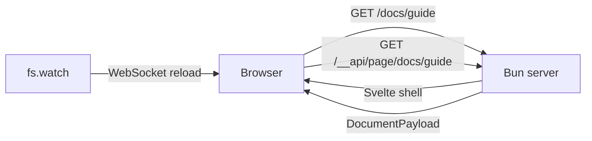

# srvmd

English | [中文](./README_CN.md)

A static file server built on Bun: host a directory like `serve`, but `.md` files are rendered as HTML on demand, and the browser reloads automatically when files change.

```bash
bunx srvmd ./docs
```

## Features

- Static file serving with automatic `Content-Type`, `ETag`, `Last-Modified`, `304 Not Modified`, and Range request support
- Markdown rendering via built-in `Bun.markdown` (CommonMark + GFM tables, strikethrough, and task lists)
- YAML frontmatter parsed with built-in `Bun.YAML`, available as page metadata such as `title` and `lang`
- Automatic heading anchors and a sidebar table of contents (TOC), with rendered output cached by file mtime
- shiki syntax highlighting with built-in light/dark themes; unknown languages fall back to plain code blocks
- Mermaid diagrams: the runtime comes from the local mermaid dependency and is loaded on demand; click a diagram to open a fullscreen viewer with zoom and pan
- File watching + WebSocket live reload, preserving scroll position across reloads
- Directory listings, clean URLs, SPA single-page fallback, CORS, and dark mode toggle
- Pages are rendered by Svelte 5 in the browser using server-routed CSR; the React dependency has been removed

## Requirements

- Bun >= 1.3.8 (`Bun.markdown` is available starting from this version)

## Installation

```bash
# Global install
bun add -g srvmd

# Or run directly
bunx srvmd ./docs
```

## Usage

```bash
srvmd [directory] [options]
```

Common examples:

```bash
srvmd ./docs                  # Host ./docs on port 3000
srvmd . -l 8080 --open        # Use a specific port and open the browser
srvmd ./public -s --cors      # SPA mode with CORS enabled
srvmd ./docs --theme dark     # Dark theme by default
```

### CLI options

| Option | Description |
| --- | --- |
| `-l, --listen <port\|host:port>` | Port or address to listen on, default `3000` |
| `-o, --open` | Open the default browser after starting |
| `-s, --single` | Fall back to `index.html` or `index.md` for unmatched paths (SPA mode) |
| `-c, --cors` | Send permissive CORS headers |
| `--theme <auto\|light\|dark>` | Default color theme, default `auto` |
| `--html <filter\|allow\|off>` | How to handle raw HTML in Markdown, default `filter` |
| `--math` | Enable `$inline$` and `$$display$$` math |
| `--ignore <name>` | Extra directory names to ignore while watching; repeatable |
| `--no-live` | Disable WebSocket live reload |
| `--no-highlight` | Disable syntax highlighting |
| `--no-mermaid` | Disable Mermaid rendering and keep code blocks |
| `--no-clean-urls` | Disable resolving `/page` to `page.md` / `page.html` |
| `--no-directory-listing` | Disable directory listings |
| `-v, --version` | Print the version |
| `-h, --help` | Print help |

### URL conventions

- `/docs/page.md` and `/docs/page` both render `page.md`; relative links and images keep working
- Append `?raw` to a Markdown request to view the original file
- A directory request without a trailing `/` receives a `301` redirect
- Hidden files and directories starting with `.` are not served or listed

## Architecture

```plaintext
src/
  cli/                 # Commander argument parsing and process lifecycle
  server/              # Bun runtime: HTTP, resolve, Markdown, directories, live
    config.ts
    constants.ts
    context.ts
    create-server.ts
    types.ts
    path.ts
    file-kinds.ts
    http/
    resolve/
    markdown/
    services/
    routes/
    assets/
  shared/              # Cross-runtime API contracts, types, protocol constants
web/                   # Svelte 5 browser application
  src/features/        # document, directory, mermaid, theme, live
  src/components/      # Cross-feature presentational components
  src/lib/             # API client, config, formatting
  src/live-static.ts   # Prebuilt live reload for static HTML
  src/styles/          # app, markdown, mermaid CSS
  public/theme-boot.js # Theme bootstrap before first paint
test/                  # Integration fixtures and Playwright E2E
```

Dependency direction:

```plaintext
cli -> server -> shared
web -> shared
server -/-> web   (only serves web/dist as static files)
web -/-> server
shared -> nothing
```

`src/server/` may only import `src/server/` and `src/shared/`; `web/` may only import `src/shared/` and itself. `test/architecture.test.ts` scans imports in `.ts` and `.svelte` files to enforce these boundaries.

The CLI entry point is `src/cli/index.ts`, exposed as the `srvmd` command. See [ARCHITECTURE.md](./ARCHITECTURE.md) (Chinese) for directory responsibilities, the API contract, and where to add features.

## How it works



After a request reaches `Bun.serve`:

1. `resolveRequest` performs path resolution and security checks (path traversal, hidden files, and symlinks that escape the root)
2. Markdown and directory routes return the same Svelte shell; static files, static HTML, and `?raw` responses are still served directly
3. Svelte reads `location.pathname` and requests `/__api/page/<path>` to get page data such as `title`, `html`, `toc`, `mermaid`, and `breadcrumbs`
4. Markdown content, TOC, and shiki highlighting are generated on the server; page structure, theme, directory pages, error pages, and the Mermaid viewer are rendered by Svelte
5. `fs.watch` watches directories individually (skipping `node_modules`, `.git`, and similar), debounces changes for 80ms, and notifies the browser over WebSocket

Every navigation is a full page request; there is no client-side router. The Mermaid runtime is loaded only when a document contains diagrams. Static HTML live reload is provided by the prebuilt `/__app/live-static.js` instead of an inline script.

## Differences from vercel `serve`

Already covered:

- Static files and directory listings
- Clean URLs (extension omitted)
- SPA fallback (`-s`)
- CORS (`-c`)
- Conditional requests and Range requests

Not implemented yet:

- `rewrites` / `redirects` / `headers` configuration
- gzip / brotli compression
- Custom `404.html` templates
- HTTPS certificate options

## Markdown support

- GFM tables, strikethrough, task lists, and autolinks are enabled by default
- The GFM tag filter removes dangerous tags such as `<script>`, `<style>`, and `<iframe>` by default; normal HTML such as `<details>` is preserved
- `--html off` disables raw HTML entirely; `--html allow` performs no filtering
- `mermaid` code fences render as diagrams: click a diagram to open a fullscreen viewer with wheel/pinch zoom, drag-to-pan, `Fit` reset, and keyboard controls. The Mermaid runtime comes from the local dependency and does not require internet access; use `--no-mermaid` to keep source code blocks
- Math is off by default (so `$HOME` and `$5` in terminal docs are not misdetected); enable it with `--math`
- Frontmatter uses YAML; non-object or invalid YAML shows a warning at the top of the page instead of crashing the server

## Security

The server listens on `0.0.0.0` by default and is reachable on the local network. It serves files from the target directory as-is. Do not use it to host a directory containing secrets. Raw HTML in Markdown is only GFM-filtered by default; if you expose the server more broadly, prefer `--html off`.

## Development

```bash
bun install
bun run build                    # Build the Svelte web app (web/dist)
bun run test                     # Bun + Vitest
bun run test:server              # Bun: server, shared, API/parity
bun run test:web                 # Vitest: Svelte components and browser logic
bun run test:e2e                 # Playwright: real-browser E2E
bun run typecheck                # tsc + svelte-check
bun run check                    # Biome + Prettier
bun run start example/docs       # Start the server (requires a build first)
bun run dev                      # Start the server in watch mode
bun run dev:web                  # Vite build --watch; run alongside dev for UI work
```

Playwright requires browsers to be installed first: `bunx playwright install --with-deps chromium`. On WSL2, headless mode does not need an X server; headed mode requires WSLg. If system dependencies are unavailable, run E2E with Docker:

```bash
docker run --rm --ipc=host \
  -v "$PWD":/work -w /work -v /work/node_modules \
  oven/bun:1.4.3-debian \
  bash -lc 'bun install --frozen-lockfile && bunx playwright install --with-deps chromium && bun run test:e2e'
```

Keeping the project on the Linux filesystem (for example `/home/...`) provides better file-watching performance.

Tests are colocated with code: Markdown rendering lives in `src/server/markdown/render.test.ts`, path security in `src/server/resolve/path.test.ts`, API and parity tests in `src/server/routes/`, and Svelte component tests in `web/src/**/*.test.ts`. `web/` uses Vitest; `bunfig.toml` excludes `web/**` and `test/e2e/**` from `bun test`. Use `bun run test` for the full unit suite and `bun run test:e2e` for E2E.

The `example/docs` directory is a ready-to-run sample. Static HTML live reload uses `/__app/live-static.js`, built from `web/src/live-static.ts`; the Svelte app uses `web/src/features/live/live.ts`.

## Roadmap

- gzip / brotli compression (`Bun.gzipSync`)
- `serve.json`-style `rewrites` / `redirects` / `headers`
- More Markdown extensions
- Built-in full-text search

## License

MIT
