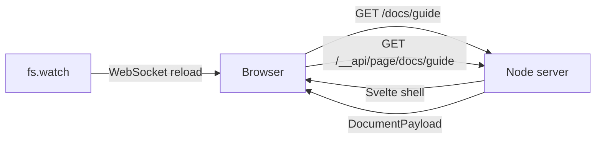

# srvmd

English | [中文](./README_CN.md)

[](https://www.npmjs.com/package/srvmd)
[](https://www.npmjs.com/package/srvmd)
[](https://nodejs.org)
[](https://github.com/luohuidong/srvmd/actions/workflows/ci.yml)
[](./LICENSE)

A static file server built on Node: host a directory like `serve`, but `.md` files are rendered as HTML on demand, and the browser reloads automatically when files change.

```bash
npx srvmd ./docs
```

## Requirements

- Node >= 26

## Installation

```bash
# Run directly
npx srvmd ./docs
pnpm dlx srvmd ./docs
```

## Usage

```bash
srvmd [directory] [options]
```

Common examples:

```bash
srvmd ./docs                  # Host ./docs on a random free port
srvmd . -p 8080 --open        # Use a specific port and open the browser
```

### CLI options

| Option | Description |
| --- | --- |
| `-p, --port <port>` | Port to listen on, default a random free port |
| `-o, --open` | Open the default browser after starting |
| `--ignore <name>` | Extra directory names to ignore while watching; repeatable |
| `-v, --version` | Print the version |
| `-h, --help` | Print help |

### URL conventions

- `/docs/page.md` renders `page.md`; the extension is required
- Append `?raw` to a Markdown request to view the original file
- A directory request without a trailing `/` receives a `301` redirect
- Directory URLs always render a generated listing; `index.md` and `index.html` are served only when requested explicitly
- Hidden files and directories starting with `.` are not served or listed
- Ignored directories such as `node_modules`, `__pycache__` and VCS metadata are not served or listed, even when requested directly

### Process lifecycle

`srvmd` runs in the foreground and stops on `Ctrl+C`, `SIGTERM` or `SIGHUP`. The last one covers closing the terminal, killing the tmux session and dropping the SSH connection, because registering a handler also overrides an ignored hangup.

Nothing else watches the process: a server whose launcher exits, or that was detached from the terminal, keeps running. Stop it with `kill`.

## Architecture

### Package layout

The repository is one public package, `srvmd`. It contains four internal
projects: the CLI, the Node server, shared contracts and the Svelte browser app.
They are built together and published in one tarball; only `srvmd` is a
user-facing package.

| Project | Runtime | Purpose |
| --- | --- | --- |
| `src/cli` | Node | CLI entry point |
| `src/server` | Node | HTTP, resolve, Markdown, directory and live-reload runtime |
| `src/shared` | None | Cross-runtime contracts, types and protocol constants |
| `src/web` | Browser | Svelte 5 browser application; Vite build to `dist/web` |

Dependency direction:

```plaintext
cli -> server -> shared          (src/cli -> src/server -> src/shared)
cli -> web dist                  (resolve ../../dist/web from the CLI module)
dev:  cli -> Vite dev URL        (server proxies shell and /__app/*)
web -> shared                    (@shared build-time alias)
server -/-> cli
server -/-> web
web -/-> server
web -/-> cli
shared -> nothing
```

`src/server` may only import itself, `src/shared` and external Node
dependencies; `src/web` may only import itself and the `@shared` alias.
`test/architecture.test.ts` scans `.ts` and `.svelte` imports to enforce these
boundaries and checks that the repository keeps one root package manifest.

The CLI entry point is `src/cli/src/index.ts`, compiled to `dist/cli/src/index.js` and
exposed as the `srvmd` command. See [ARCHITECTURE.md](./ARCHITECTURE.md) for
directory responsibilities, the API contract, and where to add features.

## How it works



After a request reaches the Node HTTP server:

1. `resolveRequest` performs path resolution and security checks (path traversal, hidden files, and symlinks that escape the root)
2. Markdown and directory routes return the same Svelte shell; static files, static HTML, and `?raw` responses are still served directly
3. Svelte reads `location.pathname` and requests `/__api/page/<path>` to get page data such as `title`, `html`, `toc`, `siblings`, `mermaid`, and `breadcrumbs`
4. Markdown content, TOC, and shiki highlighting are generated on the server; page structure, theme, directory pages, error pages, and the Mermaid viewer are rendered by Svelte
5. `fs.watch` watches directories individually (skipping `node_modules`, `.git`, and similar), debounces changes for 80ms, and notifies the browser over WebSocket

Every navigation is a full page request; there is no client-side router. The Mermaid runtime is loaded only when a document contains diagrams. Static HTML live reload is provided by the prebuilt `/__app/live-static.js` (or Vite's `src/live-static.ts` in development) instead of an inline script.

## Differences from vercel `serve`

Already covered:

- Static files and directory listings
- Conditional requests and Range requests

Not implemented yet:

- `rewrites` / `redirects` / `headers` configuration
- gzip / brotli compression
- Custom `404.html` templates
- HTTPS certificate options

## Markdown support

- GFM tables, strikethrough, task lists, and autolinks are enabled by default
- Raw HTML in Markdown is rendered as-is, with no filtering or sanitizing
- `mermaid` code fences render as diagrams: click a diagram to open a fullscreen viewer with wheel/pinch zoom, drag-to-pan, `Fit` reset, and keyboard controls. The Mermaid runtime comes from the local dependency and does not require internet access
- Dollar signs are ordinary text (`$HOME`, `$5`)
- Frontmatter uses YAML; non-object or invalid YAML shows a warning at the top of the page instead of crashing the server

## Security

The server listens on `0.0.0.0` by default and is reachable on the local network. It serves files from the target directory as-is. Do not use it to host a directory containing secrets. Raw HTML in Markdown is rendered as-is, with no filtering or sanitizing; only serve content you trust, and do not expose the server to untrusted users.

## Development

```bash
pnpm install
pnpm run build                        # Node projects + Vite build (dist and dist/web)
pnpm run build:node                   # tsc -b: shared, server and cli into dist
pnpm run build:web                    # Vite: src/web -> dist/web
pnpm test                             # Build, then run Node and web Vitest projects
pnpm run typecheck                    # tsc for each project + svelte-check
pnpm run check                        # Biome for the repository + Prettier for Svelte
pnpm run preview ./example/docs      # Run the compiled CLI after a build
pnpm run dev:web                      # UI development: start the Vite dev server
pnpm run dev:node ./example/docs      # UI development: start srvmd against Vite
```

For UI development, run the Vite dev server and `pnpm run dev:node` in separate
terminals. The `dev:node` script sets
`SRVMD_DEV_WEB_URL=http://localhost:5180` and runs the CLI from source through
`tsx watch`, so no `dist` build and no separate `tsc --watch` process are needed.
The server fetches the shell from Vite, proxies `/__app/*`, and leaves HMR to a
direct browser-to-Vite WebSocket. Open the srvmd URL, not the Vite URL. `tsx` only
strips types, so run `pnpm run typecheck` for type checking.

The content directory for the CLI commands is relative to the repository root,
so `./example/docs` points at the repository sample.

Keeping the project on the Linux filesystem (for example `/home/...`) provides
better file-watching performance.

Tests are colocated with code: Markdown rendering lives in
`src/server/src/markdown/render.test.ts`, path security in
`src/server/src/resolve/request.test.ts`, API and routing tests in
`src/server/src/routes/`, and Svelte component tests in
`src/web/src/**/*.test.ts`. `src/cli`, `src/server`, `src/web` and the repository
root each have a Vitest config; `pnpm test` runs all of them.

The `example/docs` directory is a ready-to-run sample. Static HTML live reload
uses `/__app/live-static.js`, built from `src/web/src/live-static.ts`; the
Svelte app uses `src/web/src/features/live/live.ts`.

## Release notes

Changes are recorded in [GitHub Releases](https://github.com/luohuidong/srvmd/releases).

## License

MIT
