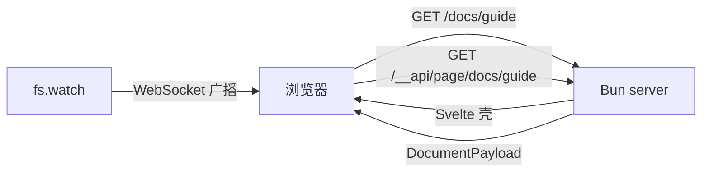

# serve-markdown

[English](./README.md) | 中文

基于 Bun 的静态文件服务器：像 `serve` 一样托管目录，但浏览 `.md` 文件时会实时渲染成 HTML，文件保存后浏览器自动刷新。

```bash
bunx serve-markdown ./docs
```

## 特性

- 静态文件服务：自动 `Content-Type`、`ETag`、`Last-Modified`、`304 Not Modified`、Range 请求
- Markdown 渲染：基于内置 `Bun.markdown`（CommonMark + GFM 表格 / 删除线 / 任务列表）
- YAML frontmatter：通过内置 `Bun.YAML` 解析，可用于 `title`、`lang` 等页面元数据
- 自动标题锚点与侧边目录（TOC），渲染结果按文件 mtime 缓存
- shiki 代码高亮，内置 light / dark 双主题，未知语言自动降级为普通代码块
- Mermaid 图表：由本地 mermaid 依赖提供运行时并按需加载，点击图表可打开支持缩放、拖拽的全屏查看器
- 文件监听 + WebSocket 实时刷新，刷新后保留滚动位置
- 目录列表、clean URLs、SPA 单页模式、CORS、深色模式切换
- 页面由 Svelte 5 在浏览器渲染，采用服务端路由 + 客户端渲染（server-routed CSR），React 依赖已移除

## 环境要求

- Bun >= 1.3.8（`Bun.markdown` 从该版本开始提供）

## 安装

```bash
# 全局安装
bun add -g serve-markdown

# 或者直接运行
bunx serve-markdown ./docs
```

## 使用

```bash
serve-markdown [directory] [options]
```

常用示例：

```bash
serve-markdown ./docs                  # 在 3000 端口托管 ./docs
serve-markdown . -l 8080 --open        # 指定端口并打开浏览器
serve-markdown ./public -s --cors      # SPA 模式并开启 CORS
serve-markdown ./docs --theme dark     # 默认深色主题
```

### CLI 参数

| 参数 | 说明 |
| --- | --- |
| `-l, --listen <port\|host:port>` | 监听端口或地址，默认 `3000` |
| `-o, --open` | 启动后打开默认浏览器 |
| `-s, --single` | 未匹配的路径回退到 `index.html` 或 `index.md`（SPA 模式） |
| `-c, --cors` | 返回宽松的 CORS 响应头 |
| `--theme <auto\|light\|dark>` | 默认配色主题，默认 `auto` |
| `--html <filter\|allow\|off>` | Markdown 中原始 HTML 的处理方式，默认 `filter` |
| `--math` | 启用 `$inline$` 与 `$$display$$` 数学公式 |
| `--ignore <name>` | 监听时额外忽略的目录名，可重复 |
| `--no-live` | 关闭 WebSocket 实时刷新 |
| `--no-highlight` | 关闭代码高亮 |
| `--no-mermaid` | 关闭 Mermaid 图表渲染，保留代码块 |
| `--no-clean-urls` | 关闭 `/page` 到 `page.md` / `page.html` 的解析 |
| `--no-directory-listing` | 关闭目录列表 |
| `-v, --version` | 输出版本号 |
| `-h, --help` | 输出帮助 |

### URL 约定

- `/docs/page.md` 与 `/docs/page` 都会渲染 `page.md`，相对链接与图片照常工作
- 在 Markdown 请求后追加 `?raw` 可以查看原始文件
- 访问目录且缺少结尾 `/` 时会收到 `301` 跳转
- 以 `.` 开头的隐藏文件不会被提供或列入目录列表

## 架构

```plaintext
src/
  cli/                 # Commander 参数解析与进程生命周期
  server/              # Bun 运行时：HTTP、resolve、Markdown、目录、live
    config.ts
    constants.ts
    context.ts
    create-server.ts
    types.ts
    path.ts
    file-kinds.ts
    http/
    resolve/
    markdown/
    services/
    routes/
    assets/
  shared/              # 跨端 API 契约、类型、协议常量
web/                   # Svelte 5 浏览器应用
  src/features/        # document、directory、mermaid、theme、live
  src/components/      # 跨 feature 的展示组件
  src/lib/             # API client、config、formatting
  src/live-static.ts   # 静态 HTML 的预构建 live reload
  src/styles/          # app、markdown、mermaid CSS
  public/theme-boot.js # 首屏前执行的主题初始化脚本
test/                  # 集成 fixture 与 Playwright E2E
```

依赖方向：

```plaintext
cli -> server -> shared
web -> shared
server -/-> web   (only serves web/dist as static files)
web -/-> server
shared -> nothing
```

`src/server/` 只能导入 `src/server/` 和 `src/shared/`；`web/` 只能导入 `src/shared/` 和自身。`test/architecture.test.ts` 会扫描 `.ts` 和 `.svelte` 的 import 来校验这些边界。

新代码统一由 `src/cli/index.ts` 启动，`serve-markdown` 和 `serve-md` 都指向这个入口。目录职责、API 契约和功能落点见 [ARCHITECTURE.md](./ARCHITECTURE.md)。

## 工作原理



请求进入 `Bun.serve` 后：

1. 用 `resolveRequest` 做路径解析与安全校验（防目录穿越、防隐藏文件、解析符号链接后仍在根目录内）
2. Markdown 和目录路由返回同一个 Svelte 壳；静态文件、静态 HTML、`?raw` 仍由服务端直接返回
3. Svelte 根据 `location.pathname` 请求 `/__api/page/<path>`，拿到 `title`、`html`、`toc`、`mermaid`、`breadcrumbs` 等页面数据
4. Markdown 正文、TOC、shiki 高亮由服务端生成；页面结构、主题、目录页、错误页、Mermaid 查看器由 Svelte 渲染
5. `fs.watch` 逐个监听目录（跳过 `node_modules`、`.git` 等），变更经 80ms 防抖后通过 WebSocket 通知浏览器刷新

每次导航都是一次完整页面请求，不使用前端 router。Mermaid 运行时只在文档包含图表时按需加载；静态 HTML 的 live reload 现在由预构建的 `/__app/live-static.js` 提供，不再注入内联脚本。

## 与 vercel `serve` 的差异

已经覆盖的能力：

- 静态文件与目录列表
- clean URLs（扩展名省略）
- SPA 单页回退（`-s`）
- CORS（`-c`）
- 文件条件请求与 Range 请求

暂未实现的能力：

- `rewrites` / `redirects` / `headers` 配置文件
- gzip / brotli 压缩
- 自定义 404 模板（`404.html`）
- HTTPS 证书参数

## Markdown 支持情况

- 默认开启 GFM 表格、删除线、任务列表、自动链接
- 默认使用 GFM tag filter 过滤 `<script>`、`<style>`、`<iframe>` 等危险标签；`<details>` 等正常 HTML 会保留
- `--html off` 会完全禁用原始 HTML，`--html allow` 则不做任何过滤
- `mermaid` 代码块会渲染为图表：点击图表打开全屏查看器，支持滚轮 / 双指缩放、拖拽平移、`Fit` 重置与键盘操作。Mermaid 运行时来自本地依赖，不依赖外网；不需要图表时可加 `--no-mermaid` 保留源码代码块
- 数学公式默认关闭（终端文档里的 `$HOME`、`$5` 不会被误判），需要时加 `--math`
- frontmatter 使用 YAML，非对象或非法 YAML 会在页面顶部显示警告而不会导致服务崩溃

## 安全提示

默认监听 `0.0.0.0`，局域网内可访问，并且会按原样提供所服务目录中的文件。请勿用它托管包含密钥的目录。Markdown 中的原始 HTML 默认只做 GFM 过滤，如果要对外暴露，建议使用 `--html off`。

## 开发

```bash
bun install
bun run build                    # 构建 Svelte Web 应用（web/dist）
bun run test                     # Bun + Vitest
bun run test:server              # Bun：server、shared 与 API/parity
bun run test:web                 # Vitest：Svelte 组件与浏览器逻辑
bun run test:e2e                 # Playwright：真实浏览器 E2E
bun run typecheck                # tsc + svelte-check
bun run check                    # Biome + Prettier
bun run start example/docs       # 启动服务（需要先 build）
bun run dev                      # 以 watch 模式启动服务
bun run dev:web                  # Vite build --watch，开发 UI 时与 dev 同时运行
```

Playwright 首次运行前需要安装浏览器：`bunx playwright install --with-deps chromium`。WSL2 下 headless 模式不需要 X server，可以直接运行；headed 模式需要 WSLg。没有系统依赖时也可以用 Docker 运行：

```bash
docker run --rm --ipc=host \
  -v "$PWD":/work -w /work -v /work/node_modules \
  oven/bun:1.4.3-debian \
  bash -lc 'bun install --frozen-lockfile && bunx playwright install --with-deps chromium && bun run test:e2e'
```

项目放在 Linux 文件系统（如 `/home/...`）可以获得更好的文件监听性能。

测试遵循 colocate 约定：Markdown 渲染在 `src/server/markdown/render.test.ts`，路径安全在 `src/server/resolve/path.test.ts`，API 和 parity 在 `src/server/routes/`，Svelte 组件在 `web/src/**/*.test.ts`。`web/` 使用 Vitest；`bunfig.toml` 已将 `web/**` 和 `test/e2e/**` 从 `bun test` 中排除，完整测试请用 `bun run test`，E2E 用 `bun run test:e2e`。

仓库中的 `example/docs` 是一个可直接运行的示例目录。纯静态 HTML 的 live reload 使用 `web/src/live-static.ts` 构建出的 `/__app/live-static.js`；新 Svelte 页面使用 `web/src/features/live/live.ts`。

## Roadmap

- gzip / brotli 压缩（`Bun.gzipSync`）
- `serve.json` 风格的 `rewrites` / `redirects` / `headers`
- 更多 Markdown 扩展
- 内置全文搜索

## License

MIT
