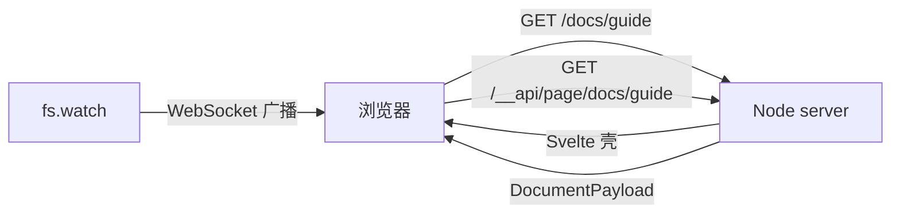

# srvmd

[English](./README.md) | 中文

基于 Node 的静态文件服务器：像 `serve` 一样托管目录，但浏览 `.md` 文件时会实时渲染成 HTML，文件保存后浏览器自动刷新。

```bash
npx srvmd ./docs
```

## 环境要求

- Node >= 26

## 安装

```bash
# 直接运行
npx srvmd ./docs
pnpm dlx srvmd ./docs
```

## 使用

```bash
srvmd [directory] [options]
```

常用示例：

```bash
srvmd ./docs                  # 在随机空闲端口托管 ./docs
srvmd . -p 8080 --open        # 指定端口并打开浏览器
```

### CLI 参数

| 参数 | 说明 |
| --- | --- |
| `-p, --port <port>` | 监听端口，默认随机空闲端口 |
| `-o, --open` | 启动后打开默认浏览器 |
| `--ignore <name>` | 监听时额外忽略的目录名，可重复 |
| `-v, --version` | 输出版本号 |
| `-h, --help` | 输出帮助 |

在 WSL 中，`--open` 会依次尝试 `wslview`（来自 [wslu](https://github.com/wslutilities/wslu)）、`cmd.exe`、`explorer.exe` 和 `xdg-open`。安装 `wslu` 可以获得最可靠的 Windows 浏览器集成。

### URL 约定

- `/docs/page.md` 渲染 `page.md`，扩展名必须保留
- 在 Markdown 请求后追加 `?raw` 可以查看原始文件
- 访问目录且缺少结尾 `/` 时会收到 `301` 跳转
- 目录 URL 始终渲染生成的列表页；`index.md` 和 `index.html` 只在被显式请求时提供
- 以 `.` 开头的隐藏文件不会被提供或列入目录列表
- `node_modules`、`__pycache__` 和版本控制元数据等目录不会被提供或列入目录列表，直接请求也会返回 404

### 进程生命周期

`srvmd` 在前台运行，`Ctrl+C`、`SIGTERM` 或 `SIGHUP` 都会干净退出。后者覆盖关闭终端、杀掉 tmux 会话和 SSH 断开，因为注册处理器同时会覆盖被忽略的挂断信号。

除此之外不追踪进程：启动它的 shell 退出、或主动脱离终端后，服务会继续运行，用 `kill` 结束。

## 架构

### 包布局

仓库只有一个 public package：`srvmd`。它包含四个内部项目：CLI、Node server、
shared 契约和 Svelte 浏览器应用。它们一起构建、一起发布到一个 tarball；用户只接触
`srvmd`。

| 项目 | 运行时 | 职责 |
| --- | --- | --- |
| `src/cli` | Node | CLI 入口 |
| `src/server` | Node | HTTP、resolve、Markdown、目录与 live reload 运行时 |
| `src/shared` | 无 | 跨端契约、类型与协议常量 |
| `src/web` | 浏览器 | Svelte 5 浏览器应用；Vite 构建到 `dist/web` |

```plaintext
src/
  cli/                 # CLI 项目
    src/               # 参数、启动、信号、web 路径解析
  server/              # Node 运行时项目
    src/               # config、HTTP、resolve、Markdown、services、routes、assets
    test/              # server 测试 fixture
  shared/              # 跨端契约项目
    src/               # 跨端 API 契约、类型、协议常量
  web/                 # Svelte 5 浏览器应用；配置在项目根，源码在 web/src
    src/features/      # document、directory、mermaid、theme、live
    src/components/    # 跨 feature 的展示组件
    src/lib/           # API client、formatting
    src/live-static.ts # 静态 HTML 的预构建 live reload
    src/styles/        # app、markdown、mermaid CSS
    public/theme-boot.js # 首屏前执行的主题初始化脚本
    vite.config.ts     # Vite 构建/开发配置
    vitest.config.ts   # 浏览器测试

dist/
  cli/src/             # Node 构建产物；bin 入口是 dist/cli/src/index.js
  server/src/
  shared/src/
  web/                 # Vite 生成产物，随 package 发布

test/                  # 仓库级架构与 package 测试
```

依赖方向：

```plaintext
cli -> server -> shared          (src/cli -> src/server -> src/shared)
cli -> web dist                  (从 CLI 模块解析 ../../dist/web)
dev:  cli -> Vite dev URL        (server 代理 shell 和 /__app/*)
web -> shared                    (@shared 构建期别名)
server -/-> cli
server -/-> web
web -/-> server
web -/-> cli
shared -> nothing
```

`src/server` 只能导入自身、`src/shared` 和外部 Node 依赖；`src/web` 只能导入自身
和 `@shared` 别名。`test/architecture.test.ts` 会扫描 `.ts` 和 `.svelte` 的 import
来校验这些边界，并检查仓库只有一个根 package manifest。

CLI 源码入口是 `src/cli/src/index.ts`，构建为 `dist/cli/src/index.js` 后以 `srvmd` 命令运行。
目录职责、API 契约和功能落点见 [ARCHITECTURE.md](./ARCHITECTURE.md)。

## 工作原理



请求进入 Node HTTP server 后：

1. 用 `resolveRequest` 做路径解析与安全校验（防目录穿越、防隐藏文件、解析符号链接后仍在根目录内）
2. Markdown 和目录路由返回同一个 Svelte 壳；静态文件、静态 HTML、`?raw` 仍由服务端直接返回
3. Svelte 根据 `location.pathname` 请求 `/__api/page/<path>`，拿到 `title`、`html`、`toc`、`siblings`、`mermaid`、`breadcrumbs` 等页面数据
4. Markdown 正文、TOC、shiki 高亮由服务端生成；页面结构、主题、目录页、错误页、Mermaid 查看器由 Svelte 渲染
5. `fs.watch` 逐个监听目录（跳过 `node_modules`、`.git` 等），变更经 80ms 防抖后通过 WebSocket 通知浏览器刷新

每次导航都是一次完整页面请求，不使用前端 router。Mermaid 运行时只在文档包含图表时按需加载；静态 HTML 的 live reload 在正式模式由预构建的 `/__app/live-static.js` 提供，开发模式由 Vite 的 `src/live-static.ts` 提供，不再注入内联脚本。

## 与 vercel `serve` 的差异

已经覆盖的能力：

- 静态文件与目录列表
- 文件条件请求与 Range 请求

暂未实现的能力：

- `rewrites` / `redirects` / `headers` 配置文件
- gzip / brotli 压缩
- 自定义 404 模板（`404.html`）
- HTTPS 证书参数

## Markdown 支持情况

- 默认开启 GFM 表格、删除线、任务列表、自动链接
- Markdown 中的原始 HTML 原样渲染，不做过滤或清理
- `mermaid` 代码块会渲染为图表：点击图表打开全屏查看器，支持滚轮 / 双指缩放、拖拽平移、`Fit` 重置与键盘操作。Mermaid 运行时来自本地依赖，不依赖外网
- 美元符号按普通文本处理（`$HOME`、`$5`）
- frontmatter 使用 YAML，非对象或非法 YAML 会在页面顶部显示警告而不会导致服务崩溃

## 安全提示

默认监听 `0.0.0.0`，局域网内可访问，并且会按原样提供所服务目录中的文件。请勿用它托管包含密钥的目录。Markdown 中的原始 HTML 会原样渲染，不做任何过滤或清理；只应托管可信内容，不要把它暴露给不受信任的用户。

## 开发

```bash
pnpm install
pnpm run build                        # Node 项目 + Vite 构建（dist 与 dist/web）
pnpm run build:node                   # tsc -b：shared/server/cli 构建到 dist
pnpm run build:web                    # Vite：src/web -> dist/web
pnpm test                             # 先构建，再跑 Node 和 web 的 Vitest
pnpm run typecheck                    # 各项目 tsc + svelte-check
pnpm run check                        # 整仓 Biome + Svelte 的 Prettier
pnpm run preview ./example/docs      # 启动编译产物（需先 build）
pnpm run dev:web                      # 开发 UI：启动 Vite dev server
pnpm run dev:node ./example/docs      # 开发 UI：启动指向 Vite 的 srvmd
```

开发 UI 时用两个终端分别运行 Vite dev server 和 `pnpm run dev:node`。`dev:node`
脚本会设置 `SRVMD_DEV_WEB_URL=http://localhost:5180`，并通过 `tsx watch` 直接运行
`src` 下的源码，所以不需要 `dist`，也不需要另开 `tsc --watch`。server 从 Vite 拉取
shell、代理 `/__app/*`，HMR WebSocket 由浏览器直连 Vite。浏览器应打开 srvmd 的地址，
而不是 Vite 的地址。`tsx` 只擦除类型、不做检查，类型检查用 `pnpm run typecheck`。

CLI 命令中的内容目录相对仓库根目录，所以 `./example/docs` 指向仓库中的示例目录。

项目放在 Linux 文件系统（如 `/home/...`）可以获得更好的文件监听性能。

测试遵循 colocate 约定：Markdown 渲染在
`src/server/src/markdown/render.test.ts`，路径安全在
`src/server/src/resolve/request.test.ts`，API 和 routing 在
`src/server/src/routes/`，Svelte 组件在 `src/web/src/**/*.test.ts`。
`src/cli`、`src/server`、`src/web` 和仓库根各有一份 Vitest 配置；
`pnpm test` 会依次运行它们。

仓库中的 `example/docs` 是一个可直接运行的示例目录。纯静态 HTML 的 live reload
使用 `src/web/src/live-static.ts` 构建出的 `/__app/live-static.js`；新 Svelte
页面使用 `src/web/src/features/live/live.ts`。

## Roadmap

- gzip / brotli 压缩（`node:zlib`）
- `serve.json` 风格的 `rewrites` / `redirects` / `headers`
- 更多 Markdown 扩展
- 内置全文搜索

## License

MIT
