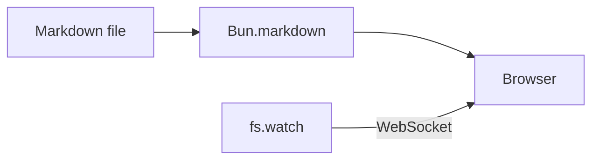

# Welcome

This page is rendered from Markdown by `serve-markdown`, then live-reloaded whenever the file changes on disk.

Try editing this file while the server is running.

## Markdown features

A table, some inline `code`, a [link](guide/setup.md) and a task list:

| Feature | Status |
| ------- | ------ |
| Tables  | ✅     |
| Tasks   | ✅     |

- [x] render Markdown
- [x] highlight code
- [ ] write more docs

## Syntax highlighting

```ts
export function greet(name: string): string {
  return `Hello, ${name}!`;
}
```

## Raw HTML

<details>
<summary>HTML blocks still work</summary>

The GFM tag filter keeps normal HTML such as `<details>` and `<kbd>`.

</details>

Press <kbd>Ctrl</kbd> + <kbd>C</kbd> to stop the server.

## Mermaid diagrams



Click the diagram to open it in a pan and zoom viewer.
